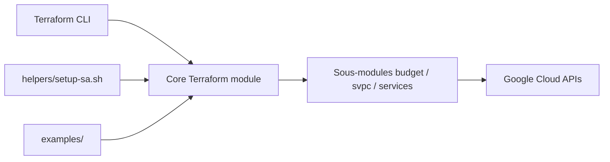

# terraform-google-modules/terraform-google-project-factory

> Module Terraform pour créer des projets Google Cloud avec Shared VPC, IAM, comptes de service et API prêts.

## Le problème
Créer des projets GCP cohérents (facturation, réseau partagé, droits, API) à la main produit des écarts entre équipes.

## Ce que ça fait vraiment
Crée le projet, l'attache au VPC partagé, supprime ou désactive le compte de service par défaut, crée un nouveau compte, lie la facturation, donne l'accès à un groupe, active les API, supprime le réseau par défaut, active le rapport d'usage, peut créer un bucket GCS. Sous-modules : budget, quotas, essential contacts, App Engine, G Suite. Un script vérifie les préconditions.

## Comment c'est branché


## Essayer
```bash
./helpers/setup-sa.sh -o <organization id> -p <project id> [-b <billing account id>]
./helpers/preconditions/preconditions.py --credentials_path "./credentials.json" --billing_account 000000-000000-000000 --org_id 000000000000
```
Usage : bloc `module "project-factory"` Terraform du README.

## Coût et pièges
Compte de service avec rôles organisation lourds (projectCreator, billing.user, xpnAdmin…). Supprimer le compte par défaut peut casser App Engine ou Cloud Scheduler.

## Ce que ce n'est pas
Pas un outil de gestion de ressources dans le projet : il ne crée que le projet et son socle. Bug connu pour déplacer un projet de l'organisation vers un dossier.

## Alternatives
- Module gsuite_enabled du même dépôt pour les groupes (cité).

## Pour toi
À surveiller : utile si ton équipe data gère plusieurs projets GCP ; sinon un projet unique se crée à la main.

