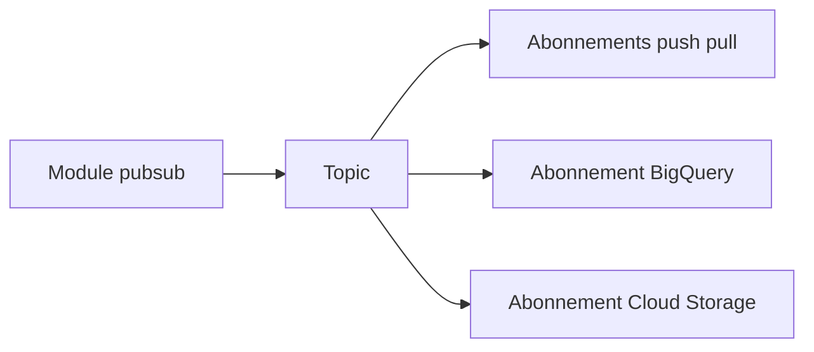

# terraform-google-modules/terraform-google-pubsub

> Terraform module that creates a Google Cloud Pub/Sub topic and its subscriptions.

## The problem
Declaring topics, subscriptions, dead-letter queues and IAM permissions by hand is repetitive and error-prone.

## What it actually does
Creates a topic and four types of subscriptions: push, pull, BigQuery and Cloud Storage. Handles the dead-letter queue, retries, message ordering, KMS encryption, a topic schema and role assignment to the Pub/Sub service account. Exports identifiers and subscription paths.

## How it is wired
Simplified diagram based on the sheet, no diagram provided.



## Trying it
```hcl
module "pubsub" {
  source  = "terraform-google-modules/pubsub/google"
  version = "~> 8.8"
  topic      = "tf-topic"
  project_id = "my-pubsub-project"
}
```

## Cost and gotchas
A Google Cloud project with the Pub/Sub API enabled and a service account with `roles/pubsub.admin`. Pub/Sub billing is at your expense. Terraform 0.13 or later.

## What it is not
Not a Pub/Sub client: it neither publishes nor reads messages. By default it grants broad roles (for example `storage.admin`) to the Pub/Sub service account.

## Alternatives
No alternative named in the README.

## For you
Adopt if your data flows go through Pub/Sub to BigQuery or GCS: ingestion becomes reproducible. Review the roles granted by default.
