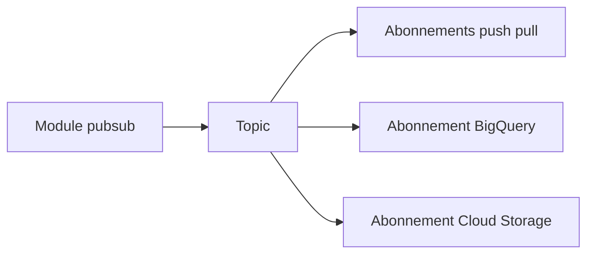

# terraform-google-modules/terraform-google-pubsub

> Module Terraform qui crée un topic Google Cloud Pub/Sub et ses abonnements.

## Le problème
Déclarer à la main topics, abonnements, files de rejet et droits IAM est répétitif et source d'erreurs.

## Ce que ça fait vraiment
Crée un topic et quatre types d'abonnements : push, pull, BigQuery et Cloud Storage. Gère la file de rejet, les tentatives, l'ordre des messages, le chiffrement KMS, un schéma de topic et l'attribution de rôles au compte de service Pub/Sub. Exporte identifiants et chemins d'abonnement.

## Comment c'est branché
Schéma simplifié d'après la fiche, sans diagramme fourni.



## Essayer
```hcl
module "pubsub" {
  source  = "terraform-google-modules/pubsub/google"
  version = "~> 8.8"
  topic      = "tf-topic"
  project_id = "my-pubsub-project"
}
```

## Coût et pièges
Projet Google Cloud avec l'API Pub/Sub activée et un compte de service avec `roles/pubsub.admin`. Facturation Pub/Sub à ta charge. Terraform 0.13 ou plus.

## Ce que ce n'est pas
Pas un client Pub/Sub : il ne publie ni ne lit de messages. Par défaut il donne des rôles larges (par exemple `storage.admin`) au compte de service Pub/Sub.

## Alternatives
Aucune alternative nommée dans le README.

## Pour toi
Adopter si tes flux de données passent par Pub/Sub vers BigQuery ou GCS : l'ingestion devient reproductible. Relis les rôles accordés par défaut.

