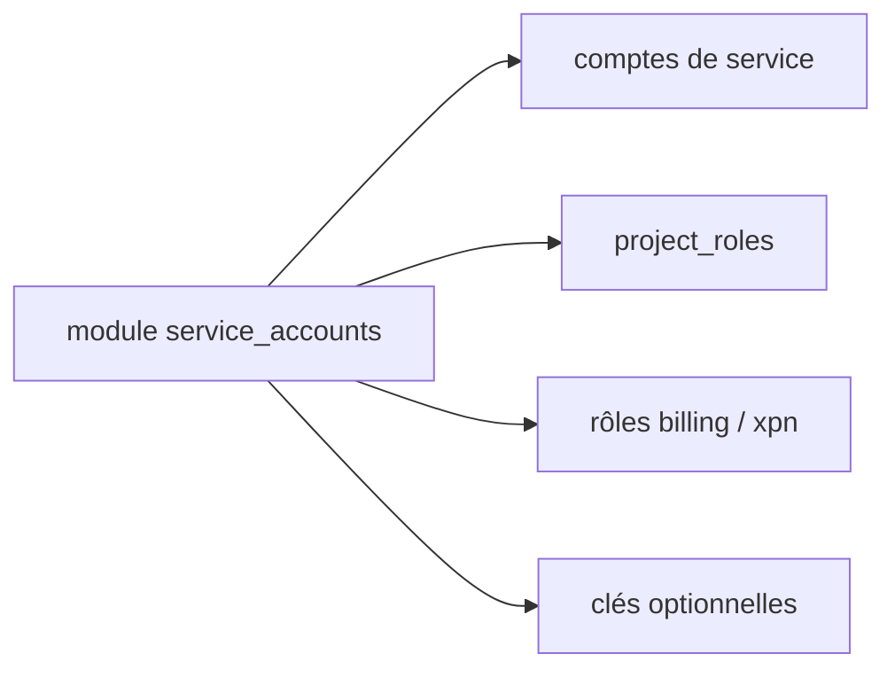

# terraform-google-modules/terraform-google-service-accounts

> Terraform module for creating GCP service accounts and granting them basic roles.

## The problem
Creating service accounts, their roles and their keys by hand is prone to omissions and drift.

## What it actually does
Creates one or more service accounts with, optionally, project roles, a billing role, two organization roles for the shared VPC, and one key per account (`generate_keys`, disabled by default). `grant_xpn_roles` is true by default.

## How it is wired


## Trying it
```bash
# module "service_accounts" { source = "terraform-google-modules/service-accounts/google" ... }
terraform init && terraform apply
```

## Cost and gotchas
An account with `roles/iam.serviceAccountAdmin` is required. Generated keys are stored in the Terraform state: protect it. The default `grant_xpn_roles = true` grants organization-level rights.

## What it is not
Not a secrets manager. Governance inferred from the owner (organization of community modules).

## Alternatives
No alternative named in the README.

## For you
Worth watching: a useful building block for ML pipeline identities on GCP, with vigilance on keys.
