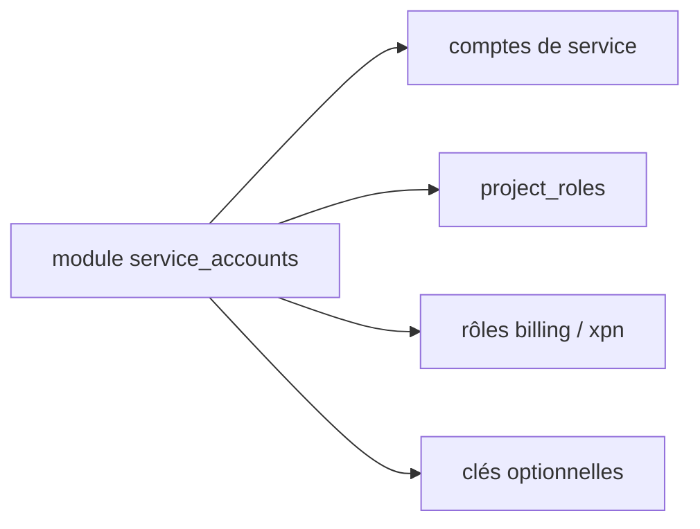

# terraform-google-modules/terraform-google-service-accounts

> Module Terraform pour créer des comptes de service GCP et leur attribuer des rôles de base.

## Le problème
Créer à la main des comptes de service, leurs rôles et leurs clés est source d'oublis et d'écarts.

## Ce que ça fait vraiment
Crée un ou plusieurs comptes de service avec, en option, des rôles projet, un rôle de facturation, deux rôles organisation pour le VPC partagé, et une clé par compte (`generate_keys`, désactivé par défaut). `grant_xpn_roles` est vrai par défaut.

## Comment c'est branché


## Essayer
```bash
# module "service_accounts" { source = "terraform-google-modules/service-accounts/google" ... }
terraform init && terraform apply
```

## Coût et pièges
Compte avec `roles/iam.serviceAccountAdmin` requis. Les clés générées sont stockées dans l'état Terraform : à protéger. Le défaut `grant_xpn_roles = true` donne des droits organisationnels.

## Ce que ce n'est pas
Pas un gestionnaire de secrets. Gouvernance déduite du propriétaire (organisation de modules communautaires).

## Alternatives
Aucune alternative nommée dans le README.

## Pour toi
Surveiller : brique utile pour les identités de pipelines ML sur GCP, avec vigilance sur les clés.

