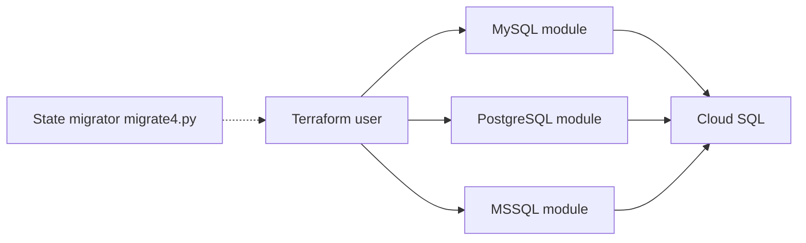

# terraform-google-modules/terraform-google-sql-db

> Terraform modules to create Cloud SQL instances (MySQL, PostgreSQL, SQL Server) with high availability on GCP.

## The problem
Provisioning Cloud SQL by hand (instances, replicas, private network, backups) is not reproducible and drifts quickly.

## What it actually does
Provides three submodules (mssql, mysql, postgresql) to call from your Terraform configuration. The tree also shows backup, restore, private-service-access and safer-MySQL modules, and a state migration utility (migrate4.py); their internal links are not established. The root module is deprecated.

## How it is wired


## Trying it
```bash
terraform init
# module "sql-db" { source = "GoogleCloudPlatform/sql-db/google//modules/postgresql" }
```

## Cost and gotchas
Cloud SQL instances are billed by GCP. Requires a service account (Cloud SQL Admin, Compute Network Admin) and several APIs enabled. The README cites inconsistent versions (26.X vs ~> 28.3 / ~> 22.0).

## What it is not
The root module is no longer used: go through a submodule. Does not manage the contents of the databases.

## Alternatives
No alternative named in the README.

## For you
Watch: relevant if your feature or MLOps metadata databases live on Cloud SQL, otherwise of no interest.
