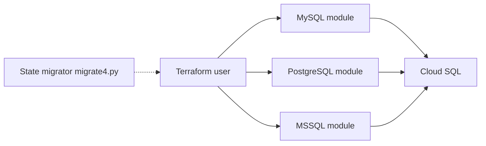

# terraform-google-modules/terraform-google-sql-db

> Modules Terraform pour créer des instances Cloud SQL (MySQL, PostgreSQL, SQL Server) avec haute disponibilité sur GCP.

## Le problème
Provisionner Cloud SQL à la main (instances, réplicas, réseau privé, sauvegardes) ne se reproduit pas et dérive vite.

## Ce que ça fait vraiment
Fournit trois sous-modules (mssql, mysql, postgresql) à appeler depuis sa configuration Terraform. L'arborescence montre aussi des modules backup, restore, private-service-access et safer-MySQL, et un utilitaire de migration d'état (migrate4.py) ; leurs liens internes ne sont pas établis. Le module racine est déprécié.

## Comment c'est branché


## Essayer
```bash
terraform init
# module "sql-db" { source = "GoogleCloudPlatform/sql-db/google//modules/postgresql" }
```

## Coût et pièges
Instances Cloud SQL facturées par GCP. Exige un compte de service (Cloud SQL Admin, Compute Network Admin) et plusieurs APIs activées. Le README cite des versions incohérentes (26.X vs ~> 28.3 / ~> 22.0).

## Ce que ce n'est pas
Le module racine ne s'utilise plus : passer par un sous-module. Ne gère pas le contenu des bases.

## Alternatives
Aucune alternative nommée dans le README.

## Pour toi
Surveiller : pertinent si tes bases de features ou de métadonnées MLOps vivent sur Cloud SQL, sinon sans intérêt.

