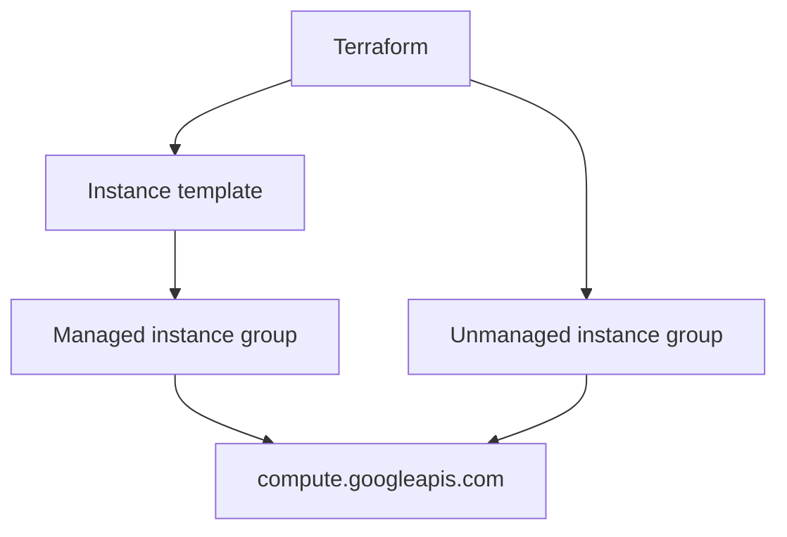

# terraform-google-modules/terraform-google-vm

> Terraform submodules to create instance templates and VM instance groups on GCP.

## The problem
Writing Compute Engine resources (instance template, managed groups) by hand is repetitive and prone to drift between projects.

## What it actually does
- Three submodules: instance template, managed instance group, unmanaged group.
- Opinionated: they set default values instead of exposing the whole API.
- Examples provided in the `examples` folder.
- Compatible with Terraform 0.13 or later, tested with 1.0 or later.

## How it is wired
Simplified diagram based on the sheet, no diagram provided.

## Trying it
No command documented: the README points to the `examples` folder.

## Cost and gotchas
The module is free, but GCP VMs are billed. You need a GCP project with `compute.googleapis.com` and `iam.googleapis.com` enabled. `distribution_policy_zones` cannot be modified: you must recreate the group by hand.

## What it is not
Not a multi-cloud abstraction layer: GCP only. Not a GKE module nor GPU compute, nothing of the sort is documented.

## Alternatives
No alternative cited in the README.

## For you
Ignore unless you provision VMs on GCP with Terraform; nothing specific to AI or MLOps here.
