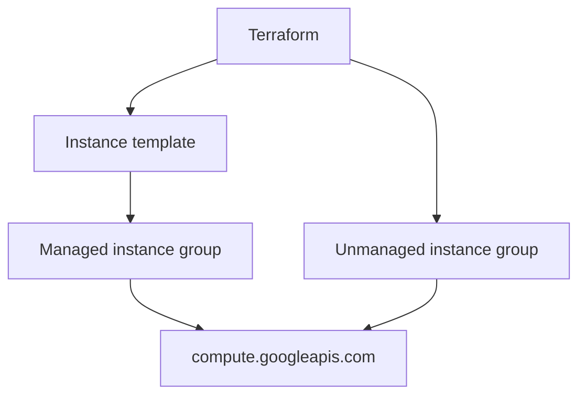

# terraform-google-modules/terraform-google-vm

> Sous-modules Terraform pour créer des modèles d'instances et groupes d'instances de VM sur GCP.

## Le problème
Écrire à la main les ressources Compute Engine (modèle d'instance, groupes managés) est répétitif et sujet aux écarts entre projets.

## Ce que ça fait vraiment
- Trois sous-modules : modèle d'instance, groupe d'instances managé, groupe non managé.
- Opinionés : ils fixent des valeurs par défaut au lieu d'exposer toute l'API.
- Exemples fournis dans le dossier `examples`.
- Compatible Terraform 0.13 ou plus, testé avec 1.0 ou plus.

## Comment c'est branché
Schéma simplifié d'après la fiche, sans diagramme fourni.

## Essayer
Aucune commande documentée : le README renvoie au dossier `examples`.

## Coût et pièges
Le module est gratuit, mais les VM GCP sont facturées. Il faut un projet GCP avec `compute.googleapis.com` et `iam.googleapis.com` activées. `distribution_policy_zones` ne se modifie pas : il faut recréer le groupe à la main.

## Ce que ce n'est pas
Pas une couche d'abstraction multi-cloud : GCP seulement. Pas un module GKE ni de calcul GPU, rien de tel n'est documenté.

## Alternatives
Aucune alternative citée dans le README.

## Pour toi
À ignorer sauf si tu provisionnes des VM sur GCP en Terraform ; rien de spécifique à l'IA ou au MLOps ici.

