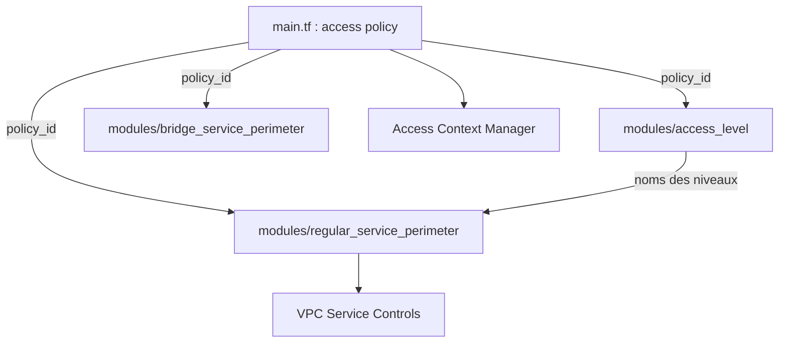

# terraform-google-modules/terraform-google-vpc-service-controls

> Terraform module that configures VPC Service Controls and Access Context Manager on Google Cloud, for platform teams.

## The problem
Setting up security perimeters around Google services such as BigQuery or Storage by hand is slow and hard to reproduce.

## What it actually does
The root module creates the access policy. Submodules add access levels, regular perimeters and "bridge" perimeters. The outputs of one feed the others, and Terraform infers the order. Examples and integration tests against real GCP are provided.

## How it is wired


## Trying it
```bash
terraform init
terraform plan
terraform apply
terraform destroy
```

## Cost and gotchas
It needs a service account with the roles/accesscontextmanager.policyAdmin role at the organization level, and the Access Context Manager API enabled. API propagation is slow: a first apply may fail, and you need to retry about 15 seconds later.

## What it is not
It is not a turnkey tool: you need a GCP organization. The README is inconsistent about versions (Terraform 1.3+ at the top, 0.12.x under "Install").

## Alternatives
- No alternative named in the README.

## For you
Worth watching: useful if you secure BigQuery or Storage data on GCP with infrastructure as code, of no interest otherwise.
