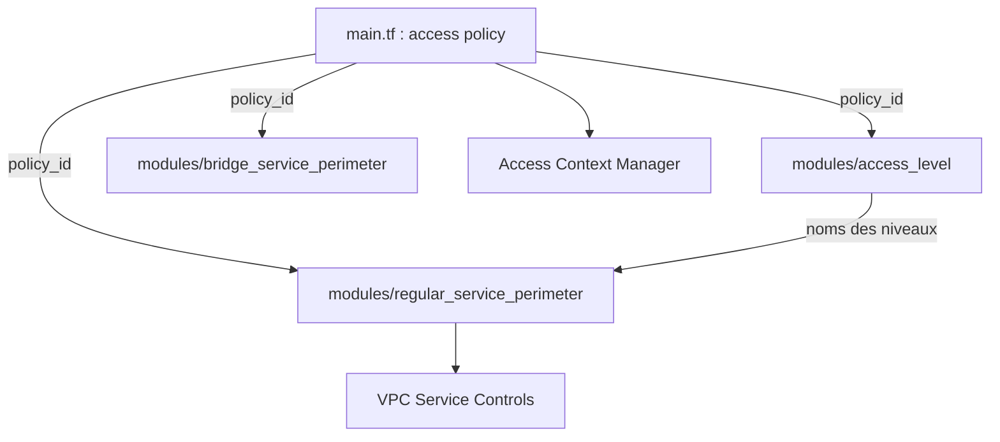

# terraform-google-modules/terraform-google-vpc-service-controls

> Module Terraform qui configure VPC Service Controls et Access Context Manager sur Google Cloud, pour les équipes plateforme.

## Le problème
Poser des périmètres de sécurité autour de services Google comme BigQuery ou Storage à la main est long et difficile à reproduire.

## Ce que ça fait vraiment
Le module racine crée la politique d'accès (access policy). Des sous-modules ajoutent les niveaux d'accès, les périmètres réguliers et les périmètres « bridge ». Les sorties de l'un nourrissent les autres, Terraform déduit l'ordre. Des exemples et des tests d'intégration sur du vrai GCP sont fournis.

## Comment c'est branché


## Essayer
```bash
terraform init
terraform plan
terraform apply
terraform destroy
```

## Coût et pièges
Il faut un compte de service avec le rôle roles/accesscontextmanager.policyAdmin au niveau de l'organisation, et l'API Access Context Manager activée. La propagation de l'API est lente : un premier apply peut échouer, il faut relancer environ 15 secondes plus tard.

## Ce que ce n'est pas
Ce n'est pas un outil clé en main : il faut une organisation GCP. Le README est incohérent sur les versions (Terraform 1.3+ en haut, 0.12.x dans « Install »).

## Alternatives
- Aucune alternative nommée dans le README.

## Pour toi
À surveiller : utile si tu sécurises des données BigQuery ou Storage sur GCP en infrastructure as code, sans intérêt autrement.

