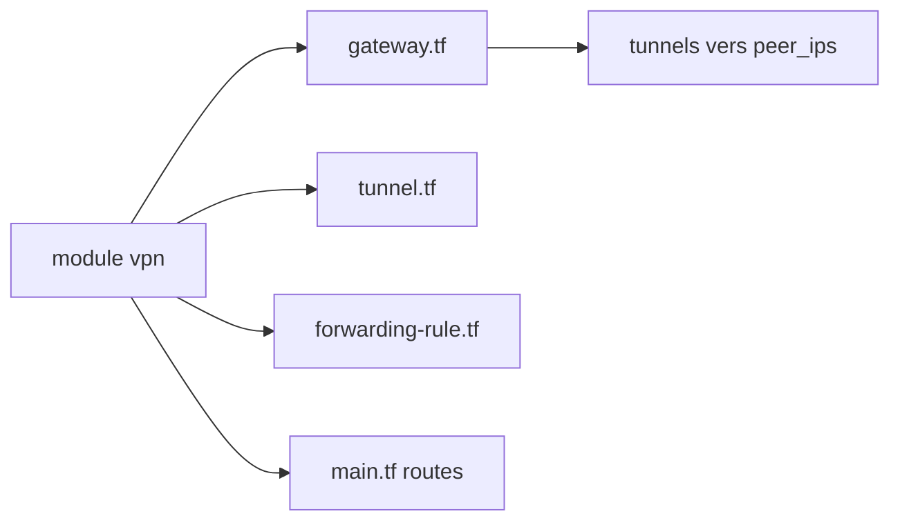

# terraform-google-modules/terraform-google-vpn

> Terraform module to create VPN gateways and tunnels on GCP, with static or dynamic routing.

## The problem
Setting up VPN connectivity to a remote site requires a gateway, tunnels, routes and forwarding rules.

## What it actually does
Creates a Google VPN gateway, tunnels to the peers, and static or dynamic routes via Cloud Router (BGP). A vpn_ha submodule covers high-availability VPN. Files: main.tf (routing), gateway.tf, tunnel.tf, forwarding-rule.tf.

## How it is wired


## Trying it
```bash
terraform init
terraform plan
terraform apply
terraform destroy
```

## Cost and gotchas
GCP VPN is billed. Requires the `roles/compute.networkAdmin` role on the organization and the Compute API enabled. `shared_secret` is in plain text in the example: protect it. The example uses `~> 1.2.0` while the README mentions Terraform 1.3+.

## What it is not
Not HA by default: you need the vpn_ha submodule.

## Alternatives
- The HA VPN submodule in the same repository.

## For you
Ignore: infrastructure networking, outside the direct needs of a data / AI profile.
