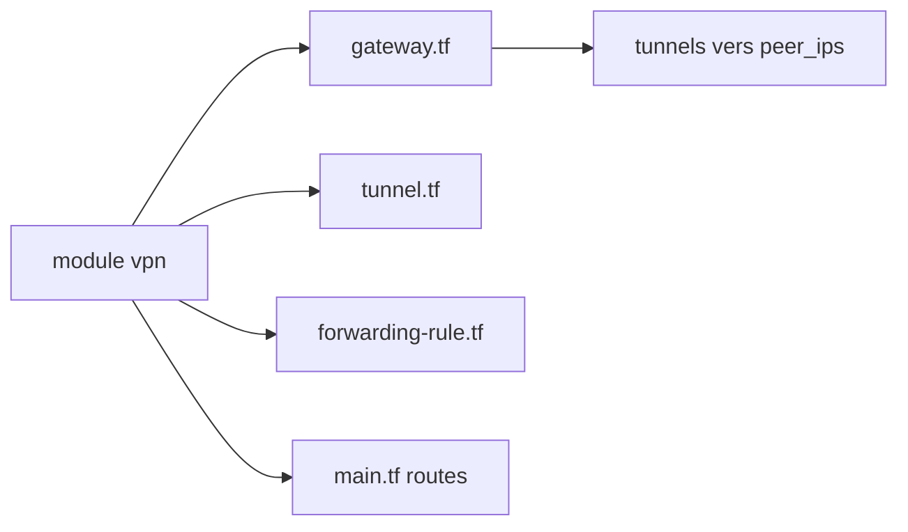

# terraform-google-modules/terraform-google-vpn

> Module Terraform pour créer des passerelles et tunnels VPN sur GCP, en routage statique ou dynamique.

## Le problème
Mettre en place une connectivité VPN vers un site distant demande passerelle, tunnels, routes et règles de forwarding.

## Ce que ça fait vraiment
Crée une passerelle VPN Google, des tunnels vers les pairs, et des routes statiques ou dynamiques via Cloud Router (BGP). Un sous-module vpn_ha couvre le VPN haute disponibilité. Fichiers : main.tf (routage), gateway.tf, tunnel.tf, forwarding-rule.tf.

## Comment c'est branché


## Essayer
```bash
terraform init
terraform plan
terraform apply
terraform destroy
```

## Coût et pièges
VPN GCP facturé. Rôle `roles/compute.networkAdmin` sur l'organisation et API Compute activée. `shared_secret` en clair dans l'exemple : à protéger. L'exemple utilise `~> 1.2.0` alors que le README parle de Terraform 1.3+.

## Ce que ce n'est pas
Pas de la HA par défaut : il faut le sous-module vpn_ha.

## Alternatives
- Le sous-module VPN HA du même dépôt.

## Pour toi
Ignorer : réseau d'infrastructure, hors des besoins directs d'un profil data / IA.

