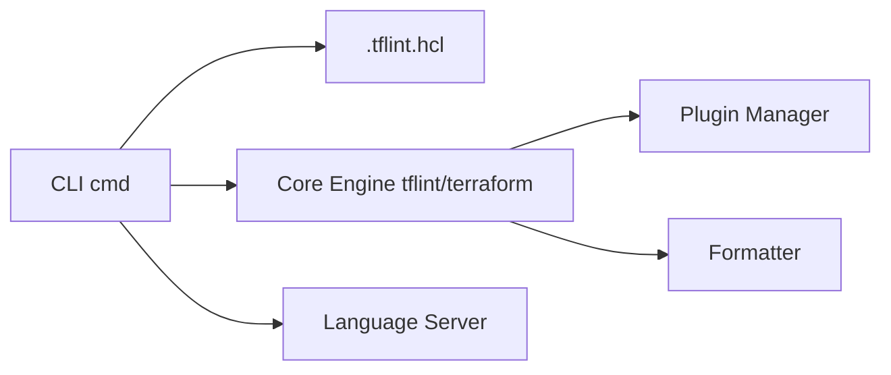

# terraform-linters/tflint

> Plugin-based Terraform linter that detects errors, deprecated syntax and deviations from conventions.

## The problem
`terraform validate` sees neither invalid instance types, nor unused declarations, nor team conventions.

## What it actually does
A lint engine where each rule comes from a plugin; Terraform ruleset included ("recommended" preset).
AWS, Azure and GCP plugins installable via `tflint --init`, custom rules as a Go plugin or in Rego (OPA).
Outputs json, checkstyle, junit, sarif; `--fix` mode, `--recursive`, language server.
Docker image and GitHub action available.

## How it is wired


## Trying it
```bash
brew install terraform-linters/tap/tflint
go install github.com/terraform-linters/tflint@latest
docker run --rm -v $(pwd):/data -t ghcr.io/terraform-linters/tflint
TFLINT_LOG=debug tflint
```

## Cost and gotchas
Free; cloud plugins are installed separately. MPL-2.0 license (weak copyleft, per file).

## What it is not
Not a full security scanner nor a plan validator: it reads the code, not the deployed state.

## Alternatives
No alternative named in the README.

## For you
Adopt in any CI that deploys ML infrastructure with Terraform: installing a binary, immediate gain on silly errors.
