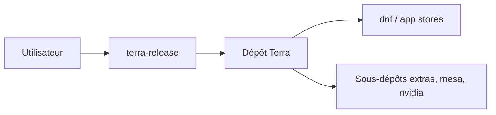

# terrapkg/packages

> Rolling-release Fedora repository whose package manifests this monorepo contains.

## The problem
Fedora does not ship all recent software, nor Mesa with full codecs or ready-to-use NVIDIA drivers.

## What it actually does
Monorepo of RPM package sources, organized by domain (applications, desktop, development tools, games, fonts, languages, system). Sub-repositories: extras, mesa, nvidia, multimedia (unstable). Fedora and EL10 support only.

## How it is wired


## Trying it
```bash
sudo dnf install --nogpgcheck --repofrompath 'terra,https://repos.fyralabs.com/terra$releasever' terra-release
```

## Cost and gotchas
Free. The repository is added with `--nogpgcheck` for the release package. The sub-repositories may conflict with RPM Fusion.

## What it is not
Not a tool to install in itself, but a package source for Fedora. Not Debian or Ubuntu.

## Alternatives
RPM Fusion, cited in the README for possible conflicts.

## For you
Ignore unless you run Fedora: useful for NVIDIA and Mesa, no effect for data work in containers.
