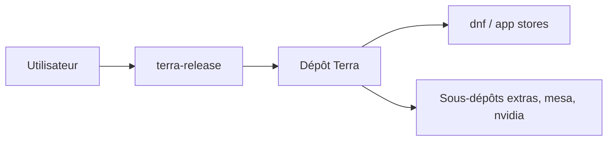

# terrapkg/packages

> Dépôt Fedora en rolling release dont ce monorepo contient les manifestes de paquets.

## Le problème
Fedora ne fournit pas tous les logiciels récents, ni Mesa avec codecs complets ou pilotes NVIDIA prêts à l'emploi.

## Ce que ça fait vraiment
Monorepo de sources de paquets RPM, organisés par domaine (applications, bureau, outils de développement, jeux, polices, langages, système). Sous-dépôts : extras, mesa, nvidia, multimedia (instable). Support Fedora et EL10 seulement.

## Comment c'est branché


## Essayer
```bash
sudo dnf install --nogpgcheck --repofrompath 'terra,https://repos.fyralabs.com/terra$releasever' terra-release
```

## Coût et pièges
Gratuit. Le dépôt s'ajoute avec `--nogpgcheck` pour le paquet de release. Les sous-dépôts peuvent entrer en conflit avec RPM Fusion.

## Ce que ce n'est pas
Pas un outil à installer en soi, mais une source de paquets pour Fedora. Pas Debian ni Ubuntu.

## Alternatives
RPM Fusion, cité dans le README pour les conflits possibles.

## Pour toi
À ignorer sauf poste Fedora : utile pour NVIDIA et Mesa, sans effet pour du travail data en conteneurs.

