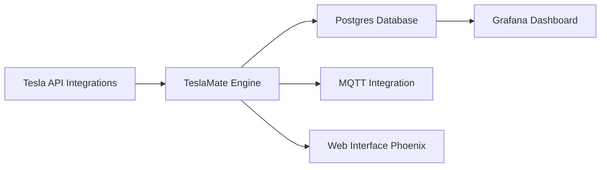

# teslamate-org/teslamate

> Self-hosted data logger for Tesla vehicles, with Grafana dashboards.

## The problem
The Tesla app offers little history: trips, charges, battery degradation, sleep.

## What it actually does
An Elixir (Phoenix) application queries the Tesla API, stores trips, charges and states in Postgres, publishes the data to an MQTT broker (Home Assistant, Node-RED) and provides about twenty Grafana dashboards. Import from TeslaFi. Interface in 19 languages.

## How it is wired

## Trying it
No command documented in the README: the documentation is at docs.teslamate.org.

## Cost and gotchas
Free, AGPL-3.0. Depends on the Tesla API and your account credentials. The README warns about fake sites and apps imitating TeslaMate: use only official sources.

## What it is not
Not an official mobile app; you have to host Postgres and Grafana.

## Alternatives
No alternative named in the README.

## For you
Ignore: for Tesla owners only; the only interest is the logging + Grafana example.
