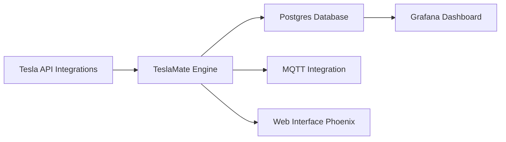

# teslamate-org/teslamate

> Journal de données auto-hébergé pour véhicules Tesla, avec tableaux de bord Grafana.

## Le problème
L'application Tesla offre peu d'historique : trajets, recharges, dégradation de batterie, veille.

## Ce que ça fait vraiment
Une application Elixir (Phoenix) interroge l'API Tesla, stocke trajets, charges et états dans Postgres, publie les données vers un broker MQTT (Home Assistant, Node-RED) et fournit une vingtaine de tableaux de bord Grafana. Import depuis TeslaFi. Interface en 19 langues.

## Comment c'est branché

## Essayer
Aucune commande documentée dans le README : la documentation est sur docs.teslamate.org.

## Coût et pièges
Gratuit, AGPL-3.0. Dépend de l'API Tesla et de tes identifiants de compte. Le README alerte sur les faux sites et applications imitant TeslaMate : n'utiliser que les sources officielles.

## Ce que ce n'est pas
Pas une application mobile officielle ; il faut héberger Postgres et Grafana.

## Alternatives
Aucune alternative nommée dans le README.

## Pour toi
Ignorer : réservé aux propriétaires de Tesla ; seul intérêt, l'exemple d'enregistrement + Grafana.

