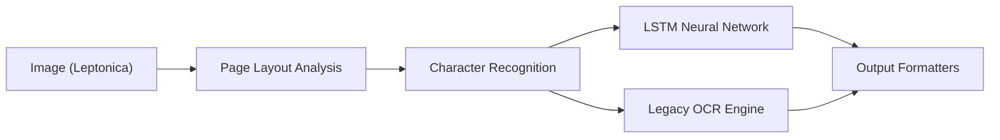

# tesseract-ocr/tesseract

> Text recognition (OCR) engine as a C++ library and command line, for developers.

## The problem
Extracting text from images or scans requires a multilingual OCR engine that can be reused in code.

## What it actually does
`libtesseract` and the `tesseract` command read PNG, JPEG and TIFF via Leptonica and produce text, hOCR, PDF, TSV, ALTO or PAGE. LSTM engine since version 4, legacy engine available with `--oem 0`. Recognizes more than 100 languages and new ones can be trained.

## How it is wired


## Trying it
```bash
tesseract imagename outputbase [-l lang] [--oem ocrenginemode] [--psm pagesegmode] [configfiles...]
tesseract --help
```

## Cost and gotchas
Free. It needs `traineddata` files (tessdata repository) and image quality determines the result; the README advises improving it before analysis.

## What it is not
No graphical interface: the README points to third-party tools. Not a document understanding solution, only text recognition.

## Alternatives
No alternative named in the README.

## For you
Adopt it: a classic, stable OCR building block for document ingestion pipelines.
