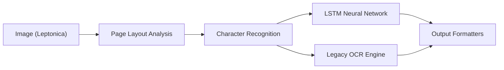

# tesseract-ocr/tesseract

> Moteur de reconnaissance de texte (OCR) en bibliothèque C++ et en ligne de commande, pour développeurs.

## Le problème
Extraire du texte à partir d'images ou de scans demande un moteur OCR multilingue réutilisable en code.

## Ce que ça fait vraiment
`libtesseract` et la commande `tesseract` lisent PNG, JPEG et TIFF via Leptonica et produisent du texte, hOCR, PDF, TSV, ALTO ou PAGE. Moteur LSTM depuis la version 4, moteur historique accessible avec `--oem 0`. Plus de 100 langues reconnues et entraînement possible de nouvelles.

## Comment c'est branché


## Essayer
```bash
tesseract imagename outputbase [-l lang] [--oem ocrenginemode] [--psm pagesegmode] [configfiles...]
tesseract --help
```

## Coût et pièges
Gratuit. Il faut des fichiers `traineddata` (dépôt tessdata) et la qualité de l'image conditionne le résultat ; le README conseille de l'améliorer avant analyse.

## Ce que ce n'est pas
Pas d'interface graphique : le README renvoie aux outils tiers. Pas une solution de compréhension de documents, seulement de reconnaissance de texte.

## Alternatives
Aucune alternative nommée dans le README.

## Pour toi
À adopter : brique OCR classique et stable pour des pipelines d'ingestion de documents.

