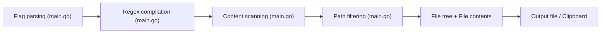

# tesserato/CodeWeaver

> Go CLI that turns a code directory into a single Markdown document for sharing or for an LLM.

## The problem
Giving an LLM an entire codebase means copying files one by one.

## What it actually does
Walks a directory, filters paths with regular expressions (include, ignore), and writes the file tree followed by file contents in Markdown code blocks. Can save the lists of included and excluded paths and copy the result to the clipboard.

## How it is wired


## Trying it
```bash
go install github.com/tesserato/CodeWeaver@latest
codeweaver
codeweaver -input=my_project -output=project_docs.md
codeweaver -include="\.go$,\.md$" -ignore="vendor,test"
```

## Cost and gotchas
Free. The generated Markdown can exceed a model's context window; filter carefully. Does not protect secrets present in the included files.

## What it is not
Not a generated-documentation or summarization tool: it concatenates raw content, with no analysis.

## Alternatives
RepoMix, gitingest, code2prompt, files-to-prompt, yek, among a long list cited in the README.

## For you
Worth watching: correct but very crowded; prefer files-to-prompt or RepoMix if you want a more widespread solution.
