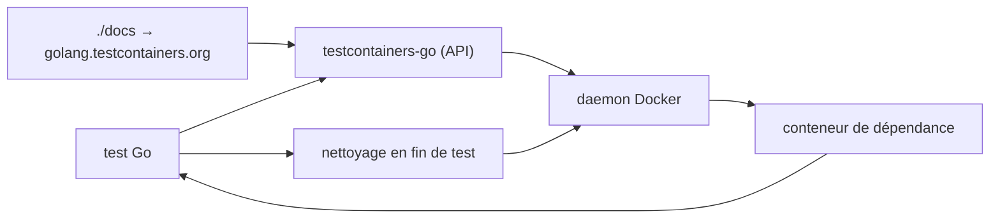

# testcontainers/testcontainers-go

> Go library to start and clean up containerized dependencies in integration tests.

## The problem
Testing Go code against a real database or broker forces you either to set up a docker-compose alongside, or to mock — and to manually clean up what is left after a test that crashes.

## What it actually does
Lets you define programmatically, in Go, the containers that must run as part of a test, then releases those resources when the test is over. That is all the README says; it points to the `golang.testcontainers.org` site, rendered from the repo's `./docs` folder, and to the getting-started guide for adding the dependency to the project.

## How it is wired

## Trying it
No command documented in the README: it points to the quick-start guide for adding the dependency to the Go project.

## Cost and gotchas
Free. A Docker daemon must be reachable from the test environment, which shifts the problem to CI (mounted socket, or Docker-in-Docker). Container startup time adds to every run of the suite.

## What it is not
Not a testing tool: it replaces neither `go test` nor assertions, it provides the dependencies. Not documented in the repo: the README is under 800 characters and all the useful content is outside the repo, so nothing is verifiable here — minimal sheet.

## Alternatives
No alternative named in the README.

## For you
Relevant only if you write Go; the Python equivalent of the same project is the real subject.
