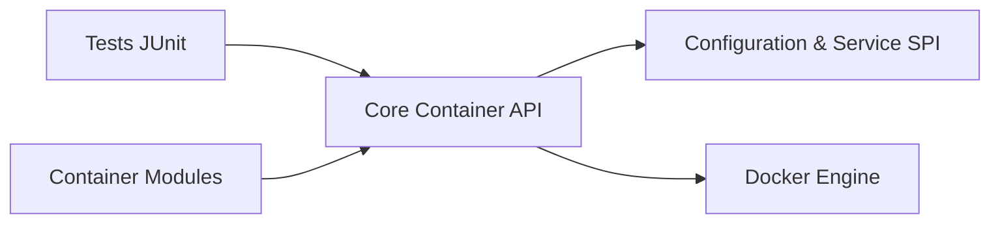

# testcontainers/testcontainers-java

> Java library providing throwaway Docker containers for JUnit tests, for Java developers.

## The problem
Integration tests need real databases or browsers, which are hard to install and reset.

## What it actually does
Starts on demand throwaway instances of databases, Selenium browsers or any service packaged in Docker, for JUnit tests. The README is minimal; judging from the architecture, a common core drives Docker and separate modules (MySQL, PostgreSQL, Redis, Neo4j…) extend it via SPI.

## How it is wired

## Trying it
No command documented in the README, which points to the online documentation.

## Cost and gotchas
Free, but Docker is required on the test machine (inferred from the description).

## What it is not
Not a database nor a CI tool. The README is too short to judge versions or limits.

## Alternatives
- No alternative named in the README.

## For you
Ignore: Java-only library, so outside your Python stack; minimal sheet for lack of material.
