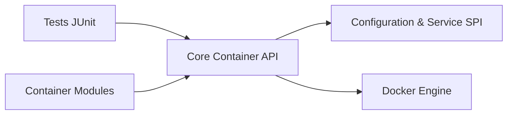

# testcontainers/testcontainers-java

> Bibliothèque Java fournissant des conteneurs Docker jetables pour tests JUnit, pour développeurs Java.

## Le problème
Les tests d'intégration ont besoin de vraies bases de données ou navigateurs, difficiles à installer et à réinitialiser.

## Ce que ça fait vraiment
Démarre à la demande des instances jetables de bases de données, navigateurs Selenium ou tout service empaqueté dans Docker, pour des tests JUnit. Le README est minimal ; d'après l'architecture, un cœur commun pilote Docker et des modules séparés (MySQL, PostgreSQL, Redis, Neo4j…) l'étendent via SPI.

## Comment c'est branché

## Essayer
Aucune commande documentée dans le README, qui renvoie vers la documentation en ligne.

## Coût et pièges
Gratuit, mais Docker est nécessaire sur la machine de test (déduit de la description).

## Ce que ce n'est pas
Pas une base de données ni un outil de CI. Le README est trop court pour juger des versions ou des limites.

## Alternatives
- Aucune alternative nommée dans le README.

## Pour toi
À ignorer : bibliothèque Java uniquement, donc hors de ta pile Python ; fiche minimale faute de matière.

