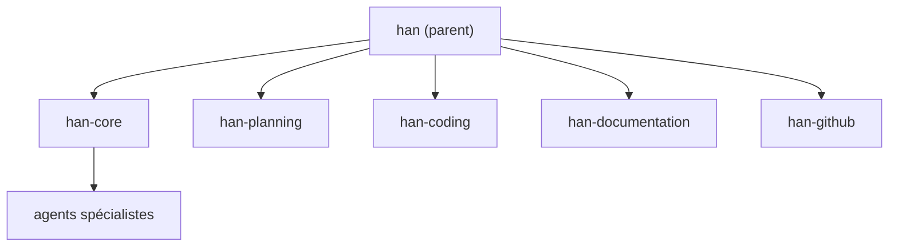

# testdouble/han

> Suite of Claude Code skills and agents for solo product engineers: plan, code, review, document.

## The problem
A lone developer does the work of a team: scoping, test-first development, critical review, documentation, PR descriptions.

## What it actually does
Named skills that chain together (planning, test-first implementation, review, docs) and dispatch specialized agents (project managers, adversarial reviewers, architecture analysts). The result is folded into a document. Several plugins: a parent `han` and layers (`han-core`, `han-planning`, `han-coding`…), plus options (Atlassian, Linear, DDD).

## How it is wired


## Trying it
```bash
/plugin marketplace add testdouble/han
/plugin install han@han
codex plugin marketplace add testdouble/han
codex plugin add han-core@han
```

## Cost and gotchas
Works from Claude Code (or Codex, without the meta-plugin or resolved dependencies). The agents consume tokens from the model used: the cost depends on your subscription or key, not specified in the README. `han-linear` requires a Linear MCP server.

## What it is not
Not designed for large teams or the enterprise, though not ruled out. Not a standalone tool: it runs inside a coding agent.

## Alternatives
No alternative named in the README.

## For you
Keep an eye on it: interesting if you code alone with Claude Code, but test it on a small project before installing the whole suite.
