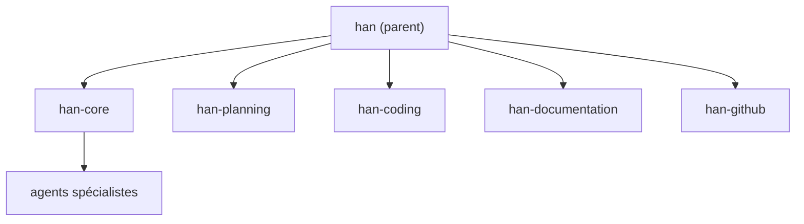

# testdouble/han

> Suite de skills et d'agents Claude Code pour ingénieurs produit solo : planifier, coder, relire, documenter.

## Le problème
Un développeur seul fait le travail d'une équipe : cadrage, tests d'abord, revue critique, documentation, description de PR.

## Ce que ça fait vraiment
Des skills nommés qui s'enchaînent (planification, implémentation test-first, revue, doc) et envoient des agents spécialisés (chefs de projet, relecteurs adverses, analystes d'architecture). Le résultat est replié dans un document. Plusieurs plugins : un parent `han` et des couches (`han-core`, `han-planning`, `han-coding`…), plus des options (Atlassian, Linear, DDD).

## Comment c'est branché


## Essayer
```bash
/plugin marketplace add testdouble/han
/plugin install han@han
codex plugin marketplace add testdouble/han
codex plugin add han-core@han
```

## Coût et pièges
Fonctionne depuis Claude Code (ou Codex, sans méta-plugin ni dépendances résolues). Les agents consomment des jetons du modèle utilisé : le coût dépend de ton abonnement ou de ta clé, non précisé dans le README. `han-linear` demande un serveur MCP Linear.

## Ce que ce n'est pas
Pas pensé pour les grandes équipes ou l'entreprise, même si ce n'est pas exclu. Pas un outil autonome : il tourne dans un agent de code.

## Alternatives
Aucune alternative nommée dans le README.

## Pour toi
Surveiller : intéressant si tu codes seul avec Claude Code, mais à tester sur un petit chantier avant d'installer toute la suite.

