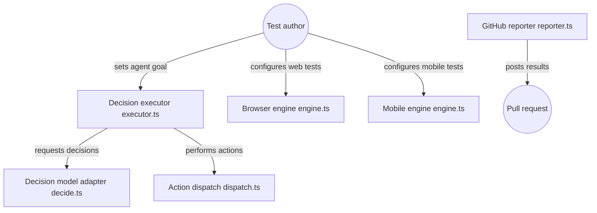

# tester-army/e2e

> Web and mobile end-to-end testing framework where an agent reaches a goal described in natural language.

## The problem
Classic E2E tests break with every interface change and require many selectors.

## What it actually does
- A test mixes natural-language `agent.act('...')` with classic locators/assertions.
- An agent step validated by an assertion is recorded, then replayed without calling the model as long as the app does not change.
- Engines: browsers via Playwright, mobile simulators and emulators.
- Integrations: hosted browsers and devices (Kernel, BrowserStack, Limrun, EAS...), PR comment reporter.

## How it is wired


## Trying it
```bash
npx e2e init
npx e2e telemetry disable
```

## Cost and gotchas
You must supply a model (subscription, API key or local model); tests without agent steps do not need one. Anonymous telemetry is enabled by default (can be disabled). Hosted providers have their own pricing.

## What it is not
Not stable: APIs and config may change before 1.0. The SDK/runner core does not appear in the provided diagram, so it is not detailed here. Replaying is not free if the app changes.

## Alternatives
The README names no alternative.

## For you
Worth watching: the model-free replay idea is interesting for testing AI apps, but it is pre-1.0 with 75 open issues.
