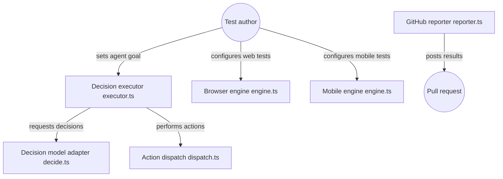

# tester-army/e2e

> Framework de tests de bout en bout web et mobile où un agent atteint un objectif décrit en langage naturel.

## Le problème
Les tests E2E classiques cassent à chaque changement d'interface et demandent beaucoup de sélecteurs.

## Ce que ça fait vraiment
- Un test mélange `agent.act('...')` en langage naturel et locators/assertions classiques.
- Un pas d'agent validé par une assertion est enregistré, puis rejoué sans appel au modèle tant que l'appli ne change pas.
- Moteurs : navigateurs via Playwright, simulateurs et émulateurs mobiles.
- Intégrations : navigateurs et appareils hébergés (Kernel, BrowserStack, Limrun, EAS...), reporter de commentaire sur PR.

## Comment c'est branché


## Essayer
```bash
npx e2e init
npx e2e telemetry disable
```

## Coût et pièges
Modèle à fournir (abonnement, clé d'API ou modèle local) ; les tests sans pas d'agent n'en ont pas besoin. Télémétrie anonyme activée par défaut (désactivable). Les fournisseurs hébergés ont leurs tarifs.

## Ce que ce n'est pas
Pas stable : APIs et config peuvent changer avant la 1.0. Le noyau SDK/runner n'apparaît pas dans le diagramme fourni, donc non détaillé ici. Rejouer n'est pas gratuit si l'appli change.

## Alternatives
Le README ne nomme aucune alternative.

## Pour toi
À surveiller : idée de rejeu sans modèle intéressante pour tester des applis IA, mais pré-1.0 avec 75 issues ouvertes.

