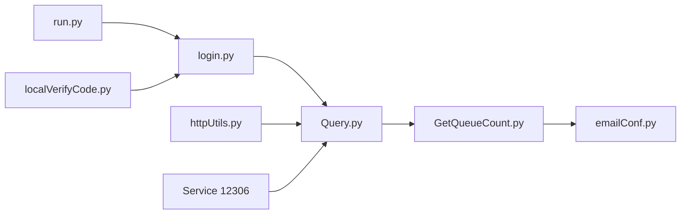

# testerSunshine/12306

> Python assistant that automatically buys train tickets on 12306, for Chinese users.

## The problem
Getting a ticket on a site that is saturated at peak times, where seats go in a few seconds.

## What it actually does
Logs into the 12306 account, polls availability in a loop, submits the order, tracks the queue and notifies by e-mail or ServerChan. Handles the smart waiting list and automatic captcha recognition (local model to download or remote server). The README is in Chinese.

## How it is wired


## Trying it
```bash
pip3 install -i https://pypi.tuna.tsinghua.edu.cn/simple -r requirements.txt
python3 run.py t
python3 run.py c
python3 run.py r
docker-compose up --build -d
```

## Cost and gotchas
A 12306 account is required, and the captcha model must be downloaded (Baidu link). The README warns that 12306 blocks server IPs: run it from home. Tested with Python 3.6 to 3.7.4.

## What it is not
Not a guarantee of a ticket: the README says the program only speeds up the purchase. The repository has been archived since April 2023, so the 12306 API may have changed.

## Alternatives
No alternative named in the README.

## For you
Ignore: archived, no updates since 2023 and tied to a specific Chinese service; its only value is as an example of a booking bot to read.
