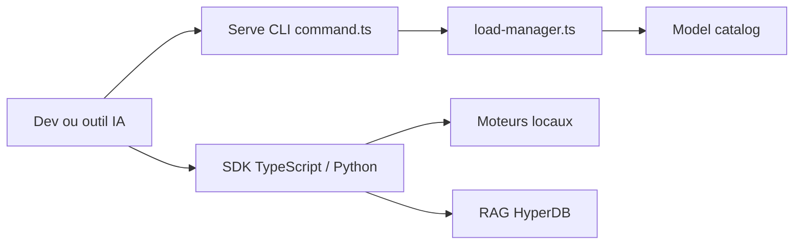

# tetherto/qvac

> JS/TS and Python SDK to run LLM, voice, vision and generation locally, with an OpenAI-compatible server.

## The problem
Running varied models on every platform means assembling many engines and depending on the cloud.

## What it actually does
A single SDK (`@qvac/sdk`, `tetherto-qvac-sdk`) loads a model and runs inference, embeddings, RAG, LoRA fine-tuning, OCR, transcription, TTS, translation, images, video, music. A `qvac serve openai` CLI exposes an OpenAI-compatible API on 127.0.0.1:11434. Models are fetched peer-to-peer through a distributed registry.

## How it is wired


## Trying it
```bash
npm i @qvac/sdk
npm install -g @qvac/cli
qvac serve openai
curl http://localhost:11434/v1/chat/completions -H 'Content-Type: application/json' -d '{"model":"my-llm","messages":[{"role":"user","content":"Hello"}]}'
```

## Cost and gotchas
Free, but models are downloaded on first launch and need RAM/GPU depending on the workload. 124 open issues; very wide scope.

## What it is not
Not a single engine: a monorepo of many backends, whose maturity varies by task.

## Alternatives
No alternative cited in the README (compatible with OpenCode, OpenClaw).

## For you
Worth watching: interesting for a multi-task local AI stack with an OpenAI API, but test the tasks that matter to you first.
