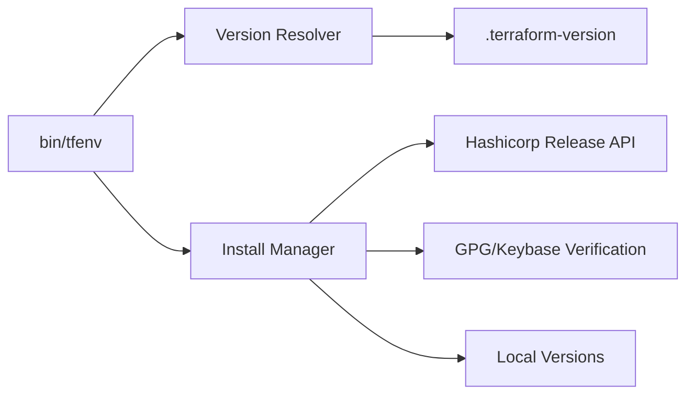

# tfutils/tfenv

> Shell-based Terraform version manager, inspired by rbenv, for anyone juggling several projects.

## The problem
Each Terraform project demands its own version; installing and switching between binaries by hand is error-prone.

## What it actually does
Installs, lists, uninstalls and selects Terraform versions. The active version is resolved through `TFENV_TERRAFORM_VERSION`, then `.terraform-version`. The `latest`, `latest:<regex>`, `min-required` and `latest-allowed` syntaxes read `required_version` in the .tf files. If `shasum` is present, the download is checked against the HashiCorp hash; keybase or GnuPG verify the signature. `tfenv pin` writes `.terraform-version`.

## How it is wired


## Trying it
```bash
brew install tfenv
tfenv install latest
tfenv use 0.7.0
tfenv list
tfenv pin
```

## Cost and gotchas
Free, no declared prerequisites. `min-required` does not parse semantic ranges: it takes the first version found. With a custom remote (Artifactory), set `TFENV_REVERSE_REMOTE` / `TFENV_SORT_VERSIONS_REMOTE`.

## What it is not
Not an infrastructure tool in itself: it only manages Terraform binaries. Signature verification is optional depending on the tools present.

## Alternatives
No alternative named in the README (inspired by rbenv).

## For you
Adopt it if you work on several Terraform codebases: one-command installation, a version file per project, hash verification.
