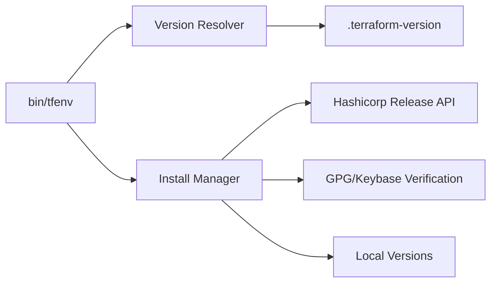

# tfutils/tfenv

> Gestionnaire de versions Terraform en shell, inspiré de rbenv, pour qui jongle entre projets.

## Le problème
Chaque projet Terraform exige sa version ; installer et basculer à la main entre binaires est source d'erreurs.

## Ce que ça fait vraiment
Installe, liste, désinstalle et sélectionne des versions de Terraform. La version active se résout via `TFENV_TERRAFORM_VERSION` puis `.terraform-version`. Les syntaxes `latest`, `latest:<regex>`, `min-required` et `latest-allowed` lisent `required_version` dans les fichiers .tf. Si `shasum` est présent, le téléchargement est vérifié contre le hash HashiCorp ; keybase ou GnuPG vérifient la signature. `tfenv pin` écrit `.terraform-version`.

## Comment c'est branché


## Essayer
```bash
brew install tfenv
tfenv install latest
tfenv use 0.7.0
tfenv list
tfenv pin
```

## Coût et pièges
Gratuit, aucun prérequis déclaré. `min-required` ne parse pas les plages sémantiques : il prend la première version trouvée. Avec un remote custom (Artifactory), régler `TFENV_REVERSE_REMOTE` / `TFENV_SORT_VERSIONS_REMOTE`.

## Ce que ce n'est pas
Pas un outil d'infrastructure en soi : il ne fait que gérer les binaires Terraform. La vérification de signature est optionnelle selon les outils présents.

## Alternatives
Aucune alternative nommée dans le README (inspiré de rbenv).

## Pour toi
À adopter si tu touches à plusieurs bases Terraform : installation en une commande, fichier de version par projet, vérification des hashes.

