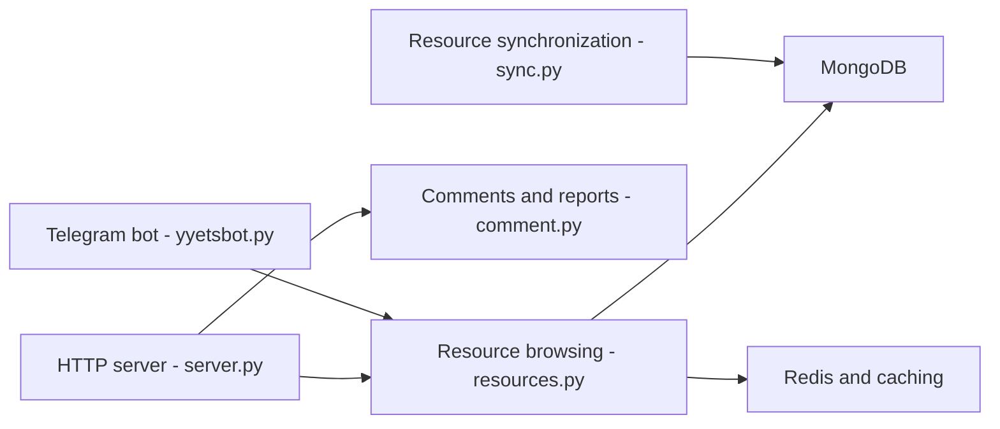

# tgbot-collection/YYeTsBot

> Website and Telegram bot indexing links to subtitled movies and series, in Chinese.

## The problem
Finding and sharing links to video resources, with favorites and comments.

## What it actually does
A Python web server (handlers for resources, comments, accounts, social login, Grafana metrics) backed by MongoDB and Redis, with search indexing, plus a Telegram bot. Tools synchronize the catalog, check comments, export the database and collect sharing links. Docker self-hosting is announced.

## How it is wired

## Trying it
No command documented in the README.

## Cost and gotchas
Free for the user; the site is funded by advertising and affiliation. Links are submitted by internet users; the README disclaims all responsibility.

## What it is not
Not a reusable technical tool. The project indexes links to protected content: copyright risk, and a README in Chinese with no deployment guide.

## Alternatives
No alternative named in the README.

## For you
Ignore: a consumer link-indexing application, with a copyright issue and no value for a data/AI/MLOps profile.
