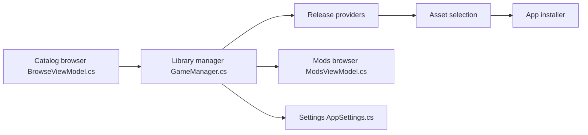

# tgeorgiadis/quiver-launcher

> Desktop launcher to download, install and run apps from GitHub/GitLab releases, with a catalog and mods.

## The problem
Installing and updating community games and ports distributed as GitHub or GitLab releases by hand, with no unified library.

## What it actually does
A renamed fork of GithubLauncher. It keeps a local library (`apps.json`), filters by tags, downloads release assets, checks their SHA-256 and launches the app. It browses the quiverlauncher.com catalog and handles Thunderstore and GameBanana mods. A kiosk mode exists. Windows and Linux are documented, macOS is "in progress".

## How it is wired


## Trying it
```bash
mkdir -p ~/QuiverLauncher
mv QuiverLauncher*.AppImage ~/QuiverLauncher/
cd ~/QuiverLauncher
chmod +x QuiverLauncher*.AppImage
./QuiverLauncher*.AppImage
```

## Cost and gotchas
Free. A GitHub token is recommended to avoid API rate limits. The catalog requires internet. Migrating from 2.4.x requires reinstalling (MIGRATING.md).

## What it is not
Not a data or MLOps tool. The catalog depends on the quiverlauncher.com site. Mods may contain NSFW content (hidden by default). macOS is not finalized.

## Alternatives
No alternative named in the README, other than GithubLauncher, of which it is a fork.

## For you
Ignore: it is a game and mod launcher unrelated to data/AI work, useful only if you play community ports.
