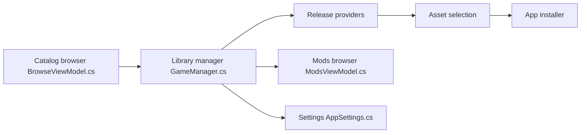

# tgeorgiadis/quiver-launcher

> Lanceur de bureau pour télécharger, installer et lancer des applis depuis des releases GitHub/GitLab, avec catalogue et mods.

## Le problème
Installer et mettre à jour à la main des jeux et ports communautaires distribués en releases GitHub ou GitLab, sans bibliothèque unifiée.

## Ce que ça fait vraiment
Fork de GithubLauncher rebaptisé. Il garde une bibliothèque locale (`apps.json`), filtre par tags, télécharge les assets de release, vérifie leur SHA-256 et lance l'appli. Il parcourt le catalogue quiverlauncher.com et gère des mods Thunderstore et GameBanana. Un mode kiosque existe. Windows et Linux sont documentés, macOS est « en cours ».

## Comment c'est branché


## Essayer
```bash
mkdir -p ~/QuiverLauncher
mv QuiverLauncher*.AppImage ~/QuiverLauncher/
cd ~/QuiverLauncher
chmod +x QuiverLauncher*.AppImage
./QuiverLauncher*.AppImage
```

## Coût et pièges
Gratuit. Un token GitHub est conseillé contre les limites d'API. Le catalogue exige internet. Migrer depuis 2.4.x impose de réinstaller (MIGRATING.md).

## Ce que ce n'est pas
Pas un outil data ou MLOps. Le catalogue dépend du site quiverlauncher.com. Les mods peuvent contenir du contenu NSFW (masqué par défaut). macOS n'est pas finalisé.

## Alternatives
Aucune alternative nommée dans le README, hormis GithubLauncher, dont il est le fork.

## Pour toi
Ignorer : c'est un lanceur de jeux et de mods sans lien avec un travail data/IA, utile seulement si tu joues à des ports communautaires.

