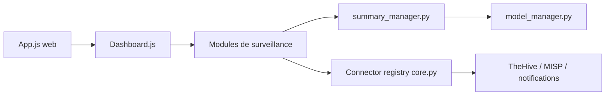

# thalesgroup-cert/Watcher

> Django/React platform for cyber threat monitoring: suspicious domains, data leaks, CVEs, AI summaries.

## The problem
A security team has to manually track CERT feeds, CVEs, domains imitating its brand and secret leaks across several platforms.

## What it actually does
- Collects CVEs, ransomware victims and CERT RSS feeds, with keyword rules triggering alerts.
- Monitors malicious domains (IP, MX, content via TLSH fuzzy hashing) and detects suspicious domains (dnstwist, certstream).
- Searches for leaks (credentials, API keys) on public code and text-sharing platforms.
- Summarises with Hugging Face models (flan-t5-base, bert-base-NER for IOC extraction); integrates with TheHive, MISP, SSO/OIDC, Slack, email.

## How it is wired


## Trying it
```bash
git clone https://github.com/thalesgroup-cert/watcher.git
cd watcher/deployment
make init
make up
make migrate
make superuser
make populate-db
# interface : http://localhost:9002
```

## Cost and gotchas
Full Docker stack with local AI models (RAM and disk). The Pastebin feature requires a pro account and an authorised public IP. AGPL-3.0 licence: obligations if a modified version is offered as a network service.

## What it is not
Not an offensive tool: it monitors threats targeting your organisation. Nor is it a SIEM: it feeds your tools (TheHive, MISP) rather than replacing them.

## Alternatives
TheHive and MISP, cited as integrations: incident management and IOC sharing platforms, which Watcher complements.

## For you
Watch: relevant if you are building a security watch with local NLP, but outside the data/MLOps core and heavy to deploy.
