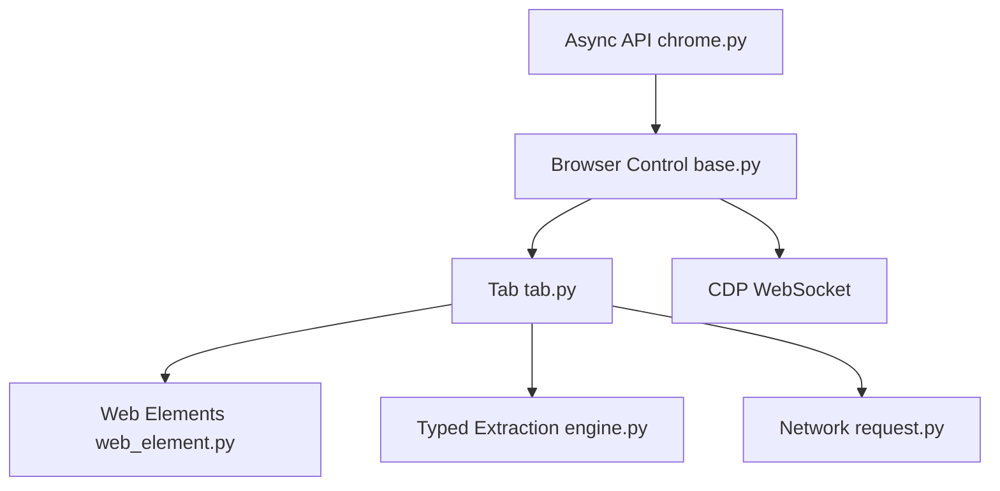

# thalissonvs/pydoll

> Asynchronous Python library driving Chrome through DevTools, without WebDriver, for automation and data extraction.

## The problem
Classic WebDriver scrapers get spotted (the `navigator.webdriver` flag) and run into anti-bot challenges; you also have to maintain a driver binary.

## What it actually does
It controls Chrome or Edge directly through the CDP protocol (WebSocket), with an asynchronous, synchronous or Playwright-compatible API. Features: human-like mouse movements and typing, browser fingerprint injection (you must supply it yourself), network interception and HAR recording, Shadow DOM and iframes, typed extraction through Pydantic models, proxies, multi-tab. The README states that passing challenges (Turnstile) is not guaranteed and depends on the IP and the browser.

## How it is wired


## Trying it
```bash
pip install pydoll-python
```

## Cost and gotchas
Free (MIT), no external binary, but Chrome or Edge must be installed. The maintainer is alone and warns of slower replies. Bypassing anti-bot protections may violate a site's terms or the law: reserve it for authorized targets.

## What it is not
Not a guaranteed bypass nor a fingerprint generator: the README says it does not provide any. A dual-use tool (testing, legitimate collection, but also detection evasion); Firefox is not supported.

## Alternatives
The README mentions a Playwright-compatible layer, but names no other repository; not documented.

## For you
Watch: typed Pydantic extraction and the asynchronous API are useful for feeding datasets, as long as collection stays compliant with the target sites' terms and the sole maintainer keeps up the pace.
