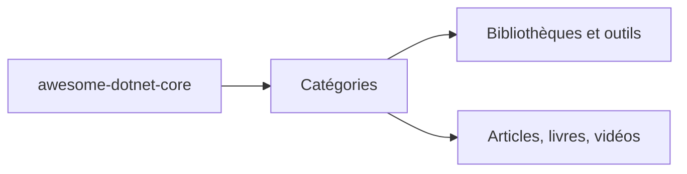

# thangchung/awesome-dotnet-core

> Categorized list of .NET Core libraries, tools and resources, for .NET developers.

## The problem
Finding the useful libraries and tools of the .NET Core ecosystem without searching the whole web.

## What it actually does
An index by category (API, authentication, cache, CMS, database, ML and data science, tests, web, etc.) with one line per project. It also accepts proprietary and commercial software. The supplied README is truncated halfway.

## How it is wired
Simplified diagram based on the fiche, no diagram supplied.

## Trying it
No command: it is a list of resources. Open the repo's README and browse the categories (frameworks, libraries, tools, tutorials) to find what you need.

## Cost and gotchas
Free, but no license declared. Several entries are old (IdentityServer4, deprecated Stormpath): check before use.

## What it is not
Not a framework nor a selection guaranteed to be up to date. The last push dates from February 2026.

## Alternatives
- awesome-dotnet (cited as an inspiration in the README): a more general sister list.

## For you
Ignore: .NET-centered list, unrelated to your data, AI or MLOps profile, and aging.
