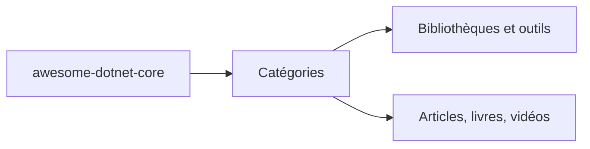

# thangchung/awesome-dotnet-core

> Liste classée de bibliothèques, outils et ressources .NET Core, pour développeurs .NET.

## Le problème
Retrouver les bibliothèques et outils utiles de l'écosystème .NET Core sans fouiller le web.

## Ce que ça fait vraiment
Un index par catégories (API, authentification, cache, CMS, base de données, ML et data science, tests, web, etc.) avec une ligne par projet. Il accepte aussi des logiciels propriétaires et commerciaux. Le README fourni est tronqué à mi-chemin.

## Comment c'est branché
Schéma simplifié d'après la fiche, sans diagramme fourni.

## Essayer
Aucune commande : c'est une liste de ressources. Ouvre le README du dépôt et parcours les catégories (frameworks, bibliothèques, outils, tutoriels) pour trouver ce dont tu as besoin.

## Coût et pièges
Gratuit, mais aucune licence déclarée. Plusieurs entrées sont anciennes (IdentityServer4, Stormpath déprécié) : à vérifier avant usage.

## Ce que ce n'est pas
Pas un framework ni une sélection à jour de façon garantie. Le dernier push date de février 2026.

## Alternatives
- awesome-dotnet (cité en inspiration dans le README) : liste sœur plus générale.

## Pour toi
À ignorer : liste centrée .NET, sans rapport avec ton profil data, IA ou MLOps, et vieillissante.

