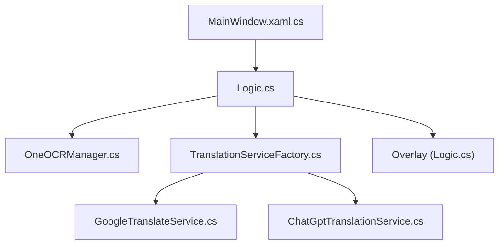

# thanhkeke97/RSTGameTranslation

> Translates the text of games, manga and voices in real time, using OCR and AI translation, on Windows.

## The problem
Playing or reading in an unknown language forces you to copy the text into a translator.

## What it actually does
Captures a window or an area, applies OCR (OneOCR or Windows OCR), translates via Google Translate (no key), Gemini, Groq, ChatGPT, Mistral, or locally with Ollama / LM Studio, then displays the translation as an overlay. Manga mode, voice translation (Whisper, FunASR), text-to-speech (Supertonic, ElevenLabs, etc.).

## How it is wired


## Trying it
```bash
# Pas de commande shell : télécharger la release, lancer rst.exe,
# Alt+Q pour choisir la zone, Alt+F overlay, Alt+G démarrer.
```

## Cost and gotchas
Windows 10 / 11, game in windowed or borderless mode. API keys optional depending on the service; Google Cloud TTS is paid, ElevenLabs has a free tier. Supertonic: about 400 MB to download.

## What it is not
Not a cross-platform tool nor an offline translator by default: the free path goes through online Google Translate.

## Alternatives
No alternative named in the README.

## For you
Shows an OCR + LLM + STT + TTS assembly usable locally with Ollama; worth watching for the idea, not for Windows gaming use.
