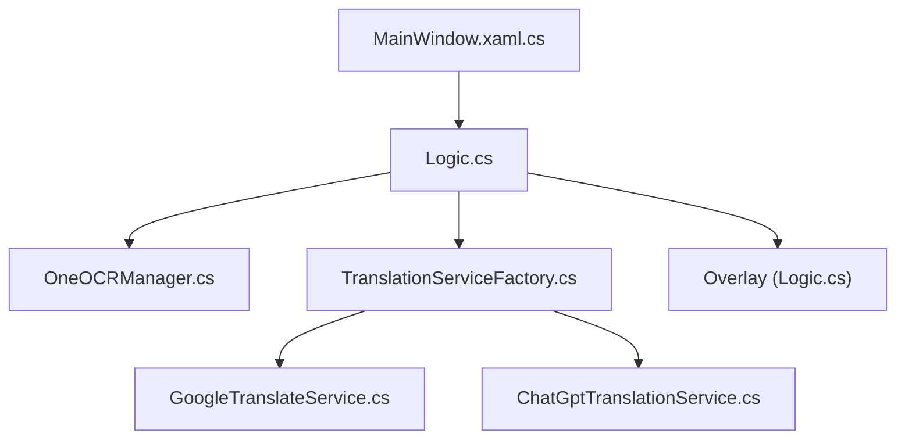

# thanhkeke97/RSTGameTranslation

> Traduit en temps réel le texte des jeux, mangas et voix, par OCR et traduction IA, sous Windows.

## Le problème
Jouer ou lire dans une langue inconnue oblige à copier le texte dans un traducteur.

## Ce que ça fait vraiment
Capture une fenêtre ou une zone, applique l'OCR (OneOCR ou Windows OCR), traduit via Google Translate (sans clé), Gemini, Groq, ChatGPT, Mistral, ou en local avec Ollama / LM Studio, puis affiche la traduction en surimpression. Mode manga, traduction de voix (Whisper, FunASR), lecture à voix haute (Supertonic, ElevenLabs, etc.).

## Comment c'est branché


## Essayer
```bash
# Pas de commande shell : télécharger la release, lancer rst.exe,
# Alt+Q pour choisir la zone, Alt+F overlay, Alt+G démarrer.
```

## Coût et pièges
Windows 10 / 11, jeu en fenêtré ou sans bordure. Clés d'API optionnelles selon le service ; Google Cloud TTS est payant, ElevenLabs a un palier gratuit. Supertonic : environ 400 Mo à télécharger.

## Ce que ce n'est pas
Pas un outil multiplateforme ni un traducteur hors ligne par défaut : le chemin gratuit passe par Google Translate en ligne.

## Alternatives
Aucune alternative nommée dans le README.

## Pour toi
Montre un assemblage OCR + LLM + STT + TTS exploitable en local avec Ollama ; à surveiller pour l'idée, pas pour l'usage Windows jeu.

