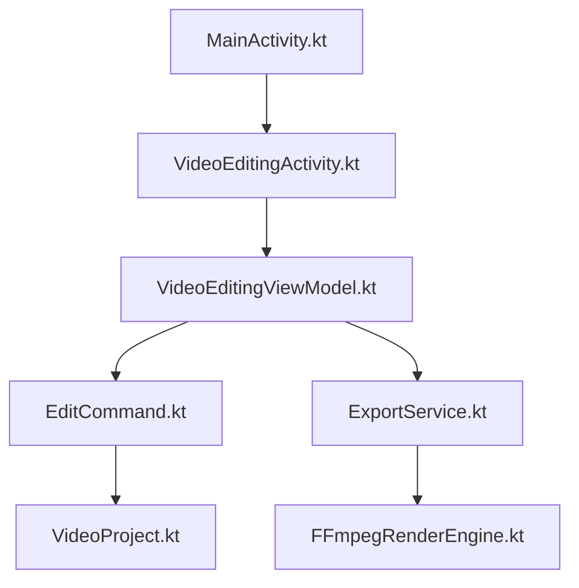

# tharunbirla/LibreCuts

> Free Android video editor that exports without a watermark and processes everything locally.

## The problem
Free mobile video editors impose a watermark, an account or uploading your videos to a server.

## What it actually does
Trim, merge, crop, speed, filters, transitions, layers (text, images, GIFs, videos) with masks, green screen overlay and keyframes. SRT subtitles, audio tracks, voice-over, MP3 export, projects saved as .lcprj. Export goes through FFmpeg with h264_mediacodec hardware acceleration.

## How it is wired


## Trying it
```bash
git clone https://github.com/tharunbirla/LibreCuts.git
```
Then open the project in Android Studio, "Make Project", "Run".

## Cost and gotchas
Free. Android Studio and the Android SDK are needed to build. Media read and write permissions.

## What it is not
Not a desktop editor. The README contains an activist appeal about the Android developer verification policy.

## Alternatives
No alternative named in the README.

## For you
Ignore: mobile video editing, unrelated to data / AI / MLOps work.
