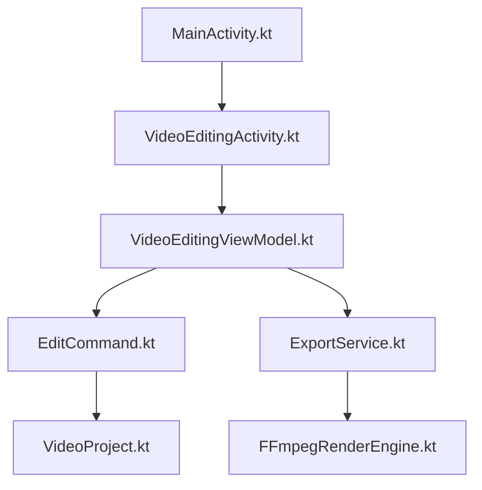

# tharunbirla/LibreCuts

> Éditeur vidéo Android libre qui exporte sans filigrane et traite tout en local.

## Le problème
Les éditeurs vidéo mobiles gratuits imposent filigrane, compte ou envoi des vidéos vers un serveur.

## Ce que ça fait vraiment
Découpe, fusion, recadrage, vitesse, filtres, transitions, calques (texte, images, GIF, vidéos) avec masques, incrustation sur fond vert et images clés. Sous-titres SRT, pistes audio, voix off, export MP3, projets enregistrables en .lcprj. L'export passe par FFmpeg avec accélération matérielle h264_mediacodec.

## Comment c'est branché


## Essayer
```bash
git clone https://github.com/tharunbirla/LibreCuts.git
```
Puis ouvrir le projet dans Android Studio, « Make Project », « Run ».

## Coût et pièges
Gratuit. Android Studio et SDK Android pour compiler. Permissions de lecture et d'écriture des médias.

## Ce que ce n'est pas
Pas un éditeur de bureau. Le README contient un appel militant sur la politique de vérification des développeurs Android.

## Alternatives
Aucune alternative nommée dans le README.

## Pour toi
Ignorer : montage vidéo mobile, sans rapport avec un travail data / IA / MLOps.

