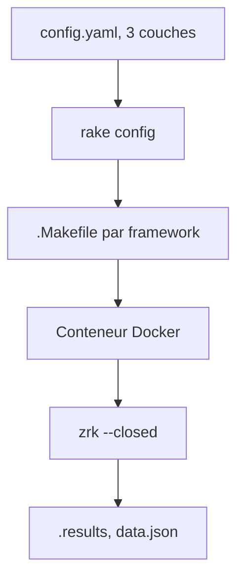

# the-benchmarker/web-frameworks

> Reproducible community benchmark of hundreds of backend web frameworks, run in containers.

## The problem
Comparing the throughput of web frameworks on a fair basis is hard without a common protocol.

## What it actually does
Each implementation exposes the same routes (`GET /`, `GET /user/:id`, `POST /user`) on port 3000. An RSpec contract checks them, then load is generated with zrk in closed loop with keep-alive. Reports give requests per second and p50 to p99 percentiles. Configuration comes from three YAML layers; a saturation file flags invalid runs. The README insists: this is a minimal test, not a real application profile.

## How it is wired
Simplified diagram based on the fiche, no diagram provided.



## Trying it
```bash
bundle install
bundle exec rake config
make -f javascript/fastify/.Makefile build
make -f javascript/fastify/.Makefile test
make -f javascript/fastify/.Makefile collect
```

## Cost and gotchas
Free, but greedy: CPU, memory, network and container storage. Real requirement: Ruby and Bundler, zrk and jq in addition to Docker. Results change with the method revision (changed in 2026) and are not comparable across revisions.

## What it is not
Not a universal verdict nor a real-application test with a database. Not a framework-choice guide on its own.

## Alternatives
No alternative named in the README.

## For you
Worth watching: useful for choosing a model API server, to be read with caution since it measures a minimal case.
