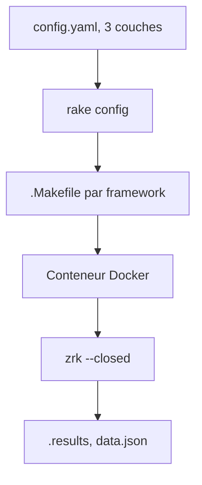

# the-benchmarker/web-frameworks

> Banc d'essai communautaire reproductible de centaines de frameworks web backend, exécutés dans des conteneurs.

## Le problème
Comparer le débit de frameworks web sur une base équitable est difficile sans protocole commun.

## Ce que ça fait vraiment
Chaque implémentation expose les mêmes routes (`GET /`, `GET /user/:id`, `POST /user`) sur le port 3000. Un contrat RSpec les vérifie, puis la charge est générée avec zrk en boucle fermée et keep-alive. Les rapports donnent requêtes par seconde et percentiles p50 à p99. La configuration vient de trois couches YAML ; un fichier de saturation signale les runs invalides. Le README insiste : c'est un test minimal, pas un profil d'application réelle.

## Comment c'est branché
Schéma simplifié d'après la fiche, sans diagramme fourni.



## Essayer
```bash
bundle install
bundle exec rake config
make -f javascript/fastify/.Makefile build
make -f javascript/fastify/.Makefile test
make -f javascript/fastify/.Makefile collect
```

## Coût et pièges
Gratuit, mais gourmand : CPU, mémoire, réseau et stockage de conteneurs. Besoin réel : Ruby et Bundler, zrk et jq en plus de Docker. Les résultats changent selon la révision de méthode (changée en 2026) et ne sont pas comparables entre elles.

## Ce que ce n'est pas
Pas un verdict universel ni un test d'application réelle avec base de données. Pas un guide de choix de framework à lui seul.

## Alternatives
Aucune alternative nommée dans le README.

## Pour toi
À surveiller : utile pour choisir un serveur d'API de modèles, à lire avec prudence car il mesure un cas minimal.

