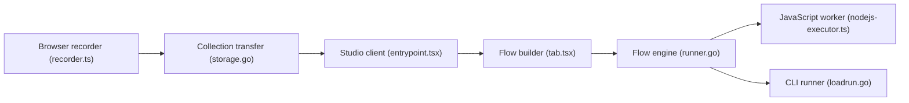

# the-dev-tools/dev-tools

> Local Postman-like API tester, with browser recording and visual flows that can run in CI.

## The problem
Common API testers require an account and the cloud, and their tests integrate poorly with CI.

## What it actually does
Desktop app and CLI: HTTP, GraphQL and WebSocket requests, collections, a flow builder (request, condition, loop and Excel data nodes) with variable chaining. A Chrome extension records requests. Import/export in a Postman-compatible format. Runs locally.

## How it is wired


## Trying it
```bash
curl -fsSL https://sh.dev.tools/install.sh | bash
wget -qO- https://sh.dev.tools/install.sh | bash
```

## Cost and gotchas
Free, no account. The installer is run via `curl | bash` and writes to `/usr/local/bin`.

## What it is not
Not a load-testing tool or a model tool; the CLI commands for running flows are not detailed in the README.

## Alternatives
Postman, cited in the README for comparison.

## For you
Worth watching: useful for testing served-model APIs, but the README is short on CLI usage in CI.
