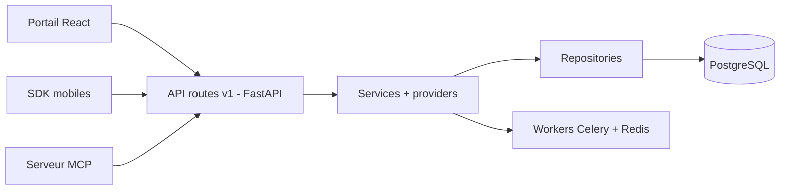

# the-momentum/open-wearables

> Self-hosted platform that unifies smartwatch data behind an API and an MCP server.

## The problem
Each provider (Garmin, Whoop, Oura, Apple Health) has its own API, OAuth flows and formats.

## What it actually does
A FastAPI backend normalizes the data (daily summaries, time series, sleep, workouts) into PostgreSQL. Celery and Redis run synchronization and history backfills. It provides webhooks, source priorities, a React developer portal and mobile SDKs (iOS, Android, Flutter, React Native). An MCP server and a Python SDK allow querying the data from an LLM. Single-organization instance.

## How it is wired


## Trying it
```bash
git clone https://github.com/the-momentum/open-wearables.git
cd open-wearables
cp ./backend/config/.env.example ./backend/config/.env
cp ./frontend/.env.example ./frontend/.env
docker compose up -d
make seed
```

## Cost and gotchas
Free when self-hosted, but the OAuth credentials of each provider must be created. The default admin account is created at startup: change the password immediately. The `docker compose` is intended for development; in production, use the official images with a stable tag.

## What it is not
It is not a medical service nor a turnkey product: the health data remains your responsibility (hosting, compliance). All the providers' limits (history) apply.

## Alternatives
No alternative named in the README.

## For you
Worth watching: a good base for feeding an AI agent with self-hosted health data, if you can handle the compliance of this sensitive data.
