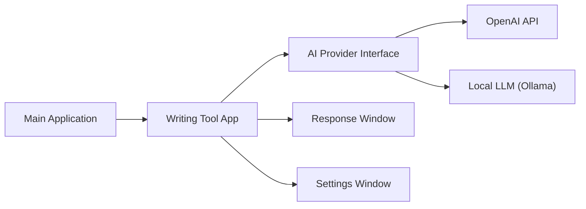

# theJayTea/WritingTools

> System-wide proofreading and rewriting assistant triggered by a keyboard shortcut, with cloud or local LLM.

## The problem
Correcting, rephrasing or summarizing text in any application means copying it to a chatbot.

## What it actually does
Select text, `ctrl+space`, choose proofread, rephrase, tone, summary, key points, table or free-form instruction; the text is replaced. Providers: Gemini, OpenAI-compatible API, Ollama, llama.cpp, Mistral. Windows and Linux in Python, macOS as a native Swift port (local MLX possible). Chat without selection, custom buttons.

## How it is wired


## Trying it
```bash
ollama pull llama3.1:8b
```
Then set the "OpenAI-Compatible" provider with the key `ollama`, the URL `http://localhost:11434/v1` and the model `llama3.1:8b`. The Windows binary is downloaded from the releases.

## Cost and gotchas
Free with Gemini (key) or local (about 8 GB of RAM/VRAM for Llama 3.1 8B). Partial Wayland support. Shortcut conflicts reported on v9. The text goes to the chosen cloud provider.

## What it is not
Not demonstrably "smarter than Grammarly": a marketing claim from the README. Rich formatting is lost in Word.

## Alternatives
No alternative named in the README.

## For you
Keep an eye on it: useful day to day with a local model to keep sensitive text at home; a single maintainer, a teenager according to the README.
