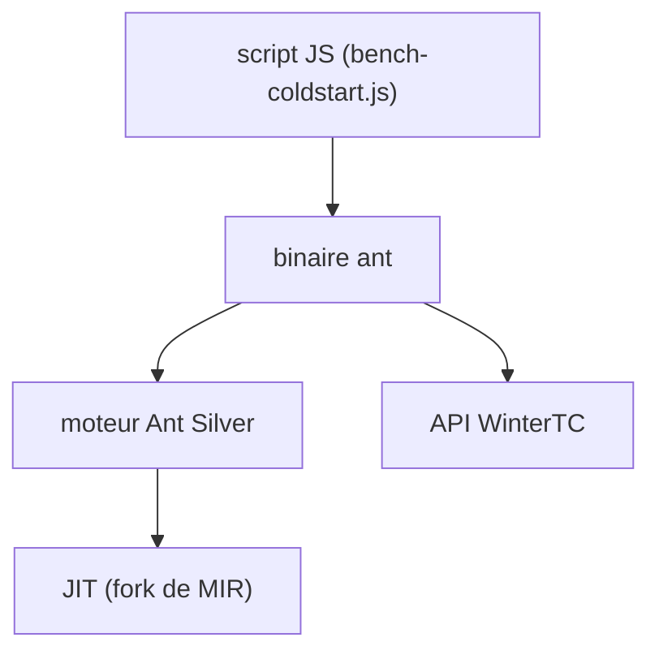

# theMackabu/ant

> Tiny JavaScript runtime with its own engine, designed for serverless, edge and command-line tools.

## The problem
Node, Bun and Deno weigh tens of MB and start slowly when you want JavaScript in a serverless function or an embedded tool.

## What it actually does
Runs JavaScript with an engine written from scratch (Ant Silver), a JIT based on a fork of MIR, for a binary of about 9 MB. Aims for WinterTC compliance. Announced results: 100% on compat-table and Temporal, about 75% on test262. The startup figures come from a single benchmark (Hono, Mac M5 Pro) published by the author.

## How it is wired

Simplified diagram based on the sheet, no diagram provided.

## Trying it
```bash
curl -fsSL https://antjs.org/install | bash
docker pull themackabu/ant:latest
docker run --rm -v "$PWD:/app" themackabu/ant:latest index.js
```

## Cost and gotchas
Free. The install script is curl piped to bash. Partial npm compatibility likely (test262 at 75%), not detailed.

## What it is not
Not a proven replacement for Node in production. The comparisons are the author's, on a single machine.

## Alternatives
Node, Bun and Deno: far greater ecosystem and maturity.

## For you
Worth watching: interesting for embedded or edge JavaScript, but young and with no direct link to your daily data and AI work.
