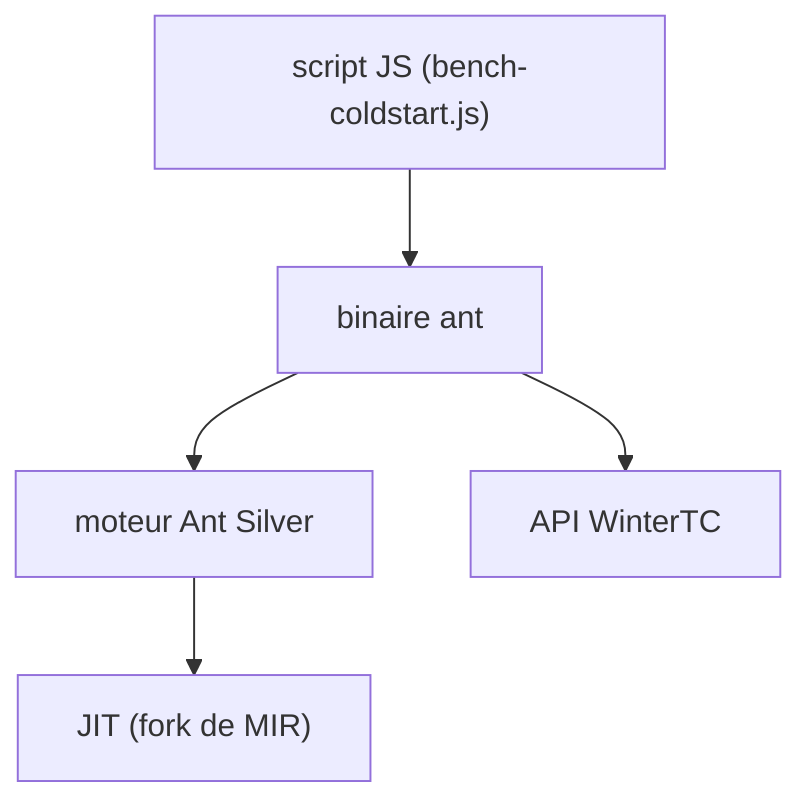

# theMackabu/ant

> Runtime JavaScript minuscule, avec son propre moteur, pensé pour serverless, edge et outils en ligne de commande.

## Le problème
Node, Bun et Deno pèsent des dizaines de Mo et démarrent lentement quand on veut du JavaScript dans une fonction serverless ou un outil embarqué.

## Ce que ça fait vraiment
Exécute du JavaScript avec un moteur écrit de zéro (Ant Silver), un JIT basé sur un fork de MIR, pour un binaire d'environ 9 Mo. Vise la conformité WinterTC. Résultats annoncés : 100 % sur compat-table et Temporal, environ 75 % sur test262. Les chiffres de démarrage viennent d'un seul banc (Hono, Mac M5 Pro) publié par l'auteur.

## Comment c'est branché

Schéma simplifié d'après la fiche, sans diagramme fourni.

## Essayer
```bash
curl -fsSL https://antjs.org/install | bash
docker pull themackabu/ant:latest
docker run --rm -v "$PWD:/app" themackabu/ant:latest index.js
```

## Coût et pièges
Gratuit. Le script d'installation est du curl vers bash. Compatibilité npm partielle probable (test262 à 75 %), non détaillée.

## Ce que ce n'est pas
Pas un remplaçant prouvé de Node en production. Les comparatifs sont ceux de l'auteur, sur une seule machine.

## Alternatives
Node, Bun et Deno : écosystème et maturité bien supérieurs.

## Pour toi
À surveiller : intéressant pour du JavaScript embarqué ou en edge, mais jeune et sans lien direct avec ton quotidien data et IA.

